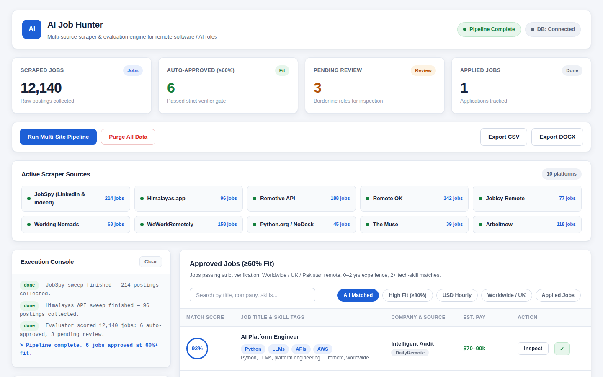
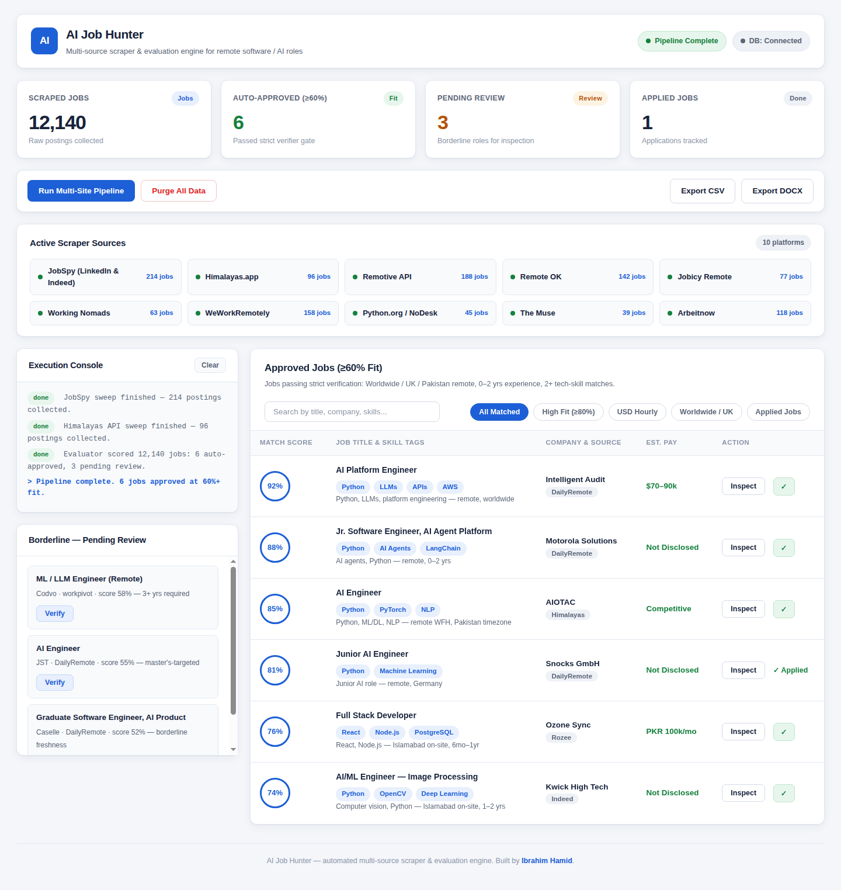

# AI Job Hunter

An automated multi-source job scraper and AI-powered evaluation engine for finding remote software and AI engineering roles — with a live pipeline control dashboard.



---

## About

**AI Job Hunter** scrapes job postings from 10+ platforms, scores each one against a candidate profile (tech-stack relevance, experience band, location/visa eligibility), and auto-approves strong matches while routing borderline roles into a manual review queue. A real-time dashboard shows pipeline metrics, per-source counts, a live execution console, and a searchable table of approved jobs with match scores, skill tags, pay estimates, and one-click exports.

It was built to run a real job hunt: remote, Pakistan-eligible, and junior-friendly (0–3 years) software/AI engineering roles — filtering out senior-only postings, region-gated listings, and QA/SDET roles automatically.



---

## Key Features

- **Multi-source scraping** — JobSpy (LinkedIn/Indeed/Glassdoor/ZipRecruiter), Himalayas API, Remotive API, Remote OK API, Jobicy, Working Nomads, WeWorkRemotely RSS, Python.org/NoDesk, The Muse, Arbeitnow.
- **Smart evaluator** — scores jobs on tech-stack fit (Python, FastAPI, React, Next.js, LangChain, RAG, MongoDB, …) and flags location/visa restrictions (e.g. US-only).
- **Auto-approval pipeline** — jobs scoring ≥ 60% are auto-approved; borderline jobs go to a **Pending Review** queue with a manual verification modal.
- **Live control dashboard** — pipeline metrics, per-source job counts, streaming execution console, search + filter pills, job inspector with full description, and mark-as-applied tracking.
- **Report exports** — one-click download of matched jobs as CSV or DOCX.
- **Dual storage** — MongoDB for persistence, with automatic fallback to in-memory mode.

---

## Project Structure

```
├── server.py              # FastAPI server: API endpoints, SSE logs, downloads, dashboard
├── main.py                # CLI pipeline runner
├── evaluator.py           # Filtering, match scoring, evaluation cache
├── database.py            # MongoDB client + schema helpers
├── log_manager.py         # Centralized logging queues
├── email_service.py       # Email digest delivery
├── application_engine.py  # Application helpers
├── scrapers/              # Site-specific scraper modules
├── jobpilot/              # Extended pipeline package (agents, services, workers)
├── static/                # Dashboard frontend (index.html, style.css, script.js)
│   ├── index.html         # Pipeline control center UI
│   ├── style.css          # Professional light theme
│   └── script.js          # Dashboard logic (SSE console, filters, modals)
└── docs/screenshots/      # Dashboard screenshots
```

---

## Setup

### 1. Prerequisites

- Python 3.10+
- *(Optional)* MongoDB Community Server for persistent storage — the app falls back to in-memory mode if MongoDB is unavailable.

### 2. Install dependencies

```bash
pip install -r requirements.txt
```

### 3. Environment variables

Create a `.env` file in the project root (see `.env.example`):

```env
GROQ_API_KEY=<your-key>
OPENROUTER_API_KEY=<your-key>
MONGO_URI=mongodb://localhost:27017/
MONGO_DB_NAME=job_scraper_db
```

### 4. Run

**Dashboard** (recommended):

```bash
python server.py
```

Then open [http://localhost:8000](http://localhost:8000) — the pipeline control center with live metrics, console, and job review.

**CLI pipeline**:

```bash
python main.py
```

---

## How the pipeline works

1. **Scrape** — each source module pulls fresh postings (titles, companies, locations, descriptions, URLs).
2. **Evaluate** — every posting is scored 0–100% on skill overlap, experience band (0–3 yrs), and geo eligibility (worldwide / Pakistan-eligible remote).
3. **Route** — ≥ 60% → approved table; borderline → pending review queue for manual verify/approve/reject.
4. **Track** — mark jobs as applied; export approved lists to CSV/DOCX; optional email digests.

---

## Tech Stack

- **Backend:** Python, FastAPI, Server-Sent Events (SSE)
- **Frontend:** Vanilla HTML/CSS/JS, Inter typeface, responsive light-theme dashboard
- **Data:** MongoDB (with in-memory fallback), CSV/DOCX export
- **Scraping:** JobSpy, REST APIs, RSS feeds, requests/BeautifulSoup

---

## Author

Built by [Ibrahim Hamid](https://github.com/IBRAHIMHAMID678) — AI Engineer working on LLM applications, RAG pipelines, voice AI, and automation tooling.
